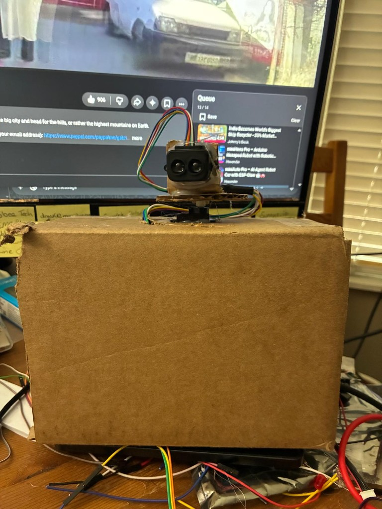

# Radar detection

A small scanning radar built on an Arduino Uno Q. A hobby servo sweeps a Benewake TF-Luna lidar across 180 degrees. A web page draws each return, and a buzzer plays a pitch that follows how far away the return is.



The sensor in the photo is the TF-Luna, taped to a cardboard horn on an A0090 servo. The servo sits on top of the project box. Power and signal wires drop into the box to the Uno Q.

## What it does

Press **Start mapping** on the page. The servo sweeps from the left stop, through straight ahead, to the right stop, and back. At each step the TF-Luna takes one range reading. The page plots that reading as a red dot on a scope and on a top-down diagram.

Distances on the page are in feet. The sensor itself measures centimeters; the page converts them.

The buzzer sounds only while something is in view:

| Distance | Pitch |
| --- | --- |
| 1 ft | 100 Hz |
| 1.5 ft | 500 Hz |
| 2 ft | 900 Hz |
| 2.5 ft | 1300 Hz |

Each extra half foot adds 400 Hz. The pitch stops climbing at 5000 Hz, which is about 7 ft. Farther returns stay at 5000 Hz. If the beam sees nothing, the buzzer goes quiet. The tone is updated from the latest detection every 0.2 seconds, so it does not retrigger on every sample. The scope still draws every return.

Straight ahead is 0 degrees. Positive angles are the left side of the beam, negative angles are the right side. That matches the way this sensor is mounted: when the lidar turns right, the dot moves right.

## Board

The Arduino Uno Q has two processors.

- The microcontroller is an STM32U585. It runs the Arduino sketch that drives the servo, reads the lidar, and plays the buzzer. The board package is `arduino:zephyr:unoq`.
- The Linux side serves the web page and forwards commands to the microcontroller. On the computer, the page talks to the board through the serial monitor bridge on `127.0.0.1:7500`. The page server opens that forward with `adb` when it starts.

The sketch that is flashed for the page is `radar/uno-q/mcu/radar/radar.ino`. Serial is `Serial` at 115200 baud (the router bridge), not the hardware UART on D0 and D1. Those pins are left free. There is no EEPROM on this board, so the page keeps the servo center and the buzzer pitch in the browser.

A few limits of this core mattered while building it:

- `Servo.write()` always treats the number as an angle from 0 to 180. Positions are sent with `writeMicroseconds()`.
- `analogWrite()` on this board is a fixed 500 Hz PWM, which will not drive a hobby servo. The servo library generates the 50 Hz pulses.
- `snprintf` with `%f` does not work here, so the sketch prints whole numbers.
- GPIO is 3.3 V. The buzzer is powered from the 3.3 V pin. The servo and the TF-Luna use 5 V.

## Wiring

### Servo, Tower Pro style A0090

| Servo wire | Uno Q |
| --- | --- |
| Signal (orange or yellow) | D10 |
| Power (red) | 5 V |
| Ground (brown or black) | GND |

D10 is also the SPI chip-select pin. The servo uses it as a pulse pin, so an SPI display would need a different chip-select.

The horn was marked where it was sitting, and that pulse is 0 degrees:

| Direction | Angle | Pulse |
| --- | --- | --- |
| Left | −90° | 500 µs |
| Ahead | 0° | 1300 µs |
| Right | +90° | 2400 µs |

The sweep uses those three pulses. 0 degrees stays at 1300 µs. The left and right ends are not equal microseconds per degree. Stop the horn short of a mechanical stop if it buzzes and stalls.

### TF-Luna

The sensor is on I2C, address `0x10`. Pin 5 must be tied to ground. If it is left open, the sensor stays in UART mode and I2C reads fail. Pin 6 is the data-ready line and is left open, so the sketch uses trigger mode: write the trigger register, wait about 20 ms, then read the distance.

| TF-Luna pin | Function | Uno Q |
| --- | --- | --- |
| 1 | +5 V | SPI2 pin 2 (5 V on the 2×3 plug) |
| 2 | SDA | D20 |
| 3 | SCL | D21 |
| 4 | GND | SPI2 pin 6 |
| 5 | Mode | GND (selects I2C) |
| 6 | Data ready | left open |

D20 and D21 are `Wire` (I2C2). They are not the Qwiic connector. Qwiic is `Wire1` at 3.3 V and is not used to power the TF-Luna.

Useful registers, little-endian:

| Register | Value |
| --- | --- |
| 0x00–0x01 | Distance, centimeters |
| 0x02–0x03 | Signal strength |
| 0x04–0x05 | Temperature, raw / 8 − 256 |
| 0x23 | Mode, set to 0x01 for trigger |
| 0x24 | Trigger, write 0x01 to take a sample |

Readings with strength below 100 are treated as weak. 65535 means overexposed. Distances outside 20–800 cm are ignored. The page trusts the sensor reading, so the stored offset is 0 cm.

### Buzzer

| Buzzer lead | Uno Q |
| --- | --- |
| VCC | 3.3 V |
| Ground | GND |
| Signal | D6 |

D6 is a PWM pin, but the pitch comes from `tone()`, which toggles the pin at the requested frequency. A steady high on D6 is only used by the **Hold high** button, for a buzzer that sounds from a DC signal.

## How it was built

Each part was brought up on its own, then combined into the one sketch the page drives.

1. The servo got two sketches: one to nudge the pulse and mark the ends, and one to sweep only after those pulses were filled in.
2. The TF-Luna got the same split: a calibration sketch that talks I2C in trigger mode, and a run sketch that prints distance after calibration.
3. The buzzer got a calibration sketch that steps the pitch from the serial monitor, and a run sketch that repeats three short beeps at the marked pitch.
4. Those behaviors were merged into `radar/uno-q/mcu/radar/radar.ino`. The page sends one text command per line. The sketch answers with one text line per event (`ready`, `mode`, `pulse`, `angle`, `dist`, `radar`, `buzz`, `weak`, and `err`).
5. The Linux-side page is a small Python server. It serves the scope and the diagram, and it forwards those commands to the microcontroller.

The standalone sketches are still in the tree. They are not what is flashed when the page is in use. Each one lives in its own folder, and the folder name matches the `.ino` file, so the Arduino build does not merge them into one sketch.

| Path | Role |
| --- | --- |
| `radar/uno-q/mcu/servo/servoCalibration/` | Find the 0° and 180° pulses |
| `radar/uno-q/mcu/servo/runServo/` | Sweep after those pulses are pasted in |
| `radar/uno-q/mcu/tfluna/calibrateTfLuna/` | Confirm the TF-Luna answers on I2C |
| `radar/uno-q/mcu/tfluna/runTfLuna/` | Print range after calibration |
| `radar/uno-q/mcu/buzzer/calibrateBuzzer/` | Pick a pitch on D6 |
| `radar/uno-q/mcu/buzzer/runBuzzer/` | Repeat that pitch |
| `radar/uno-q/mcu/radar/` | Combined sketch used by the page |
| `radar/uno-q/mpu/radar_server.py` | Web server and command bridge |
| `radar/uno-q/mpu/static/` | Scope, diagram, and controls |

## The page

Start the page from the computer that has the Uno Q plugged in:

```bash
python3 radar/uno-q/mpu/radar_server.py
```

Open `http://127.0.0.1:8080`. The header shows **MCU linked** when the bridge to port 7500 is up.

The controls are:

- **Servo.** Calibrate nudges the pulse by 20 or 100 µs, marks the current pulse as 0 degrees, and can run a test sweep. Run sweeps the 180 degree throw.
- **TF-Luna.** Calibrate shows the live distance in feet. The page uses that reading directly. Run prints the range without moving the servo.
- **Buzzer.** Calibrate steps the pitch and beeps. Run repeats three beeps at the saved pitch. During mapping or TF-Luna Run, the detection scale above takes over and the manual pattern stops.
- **Mapping.** Start mapping sweeps the servo and plots every return. Clear wipes the drawing.

The scope is the fan of angles. The diagram under it is the same points laid out around the sensor, with the gold triangle as the lidar. Red dots are detections. Labels are feet from the sensor. Dots that sit on top of each other share one label. Pointing at a dot shows that exact distance and draws a line back to the sensor.

The browser remembers the servo center (`servoZero`, default 1300 µs) and the manual buzzer pitch (`buzzerHz`).
# distance-radar
